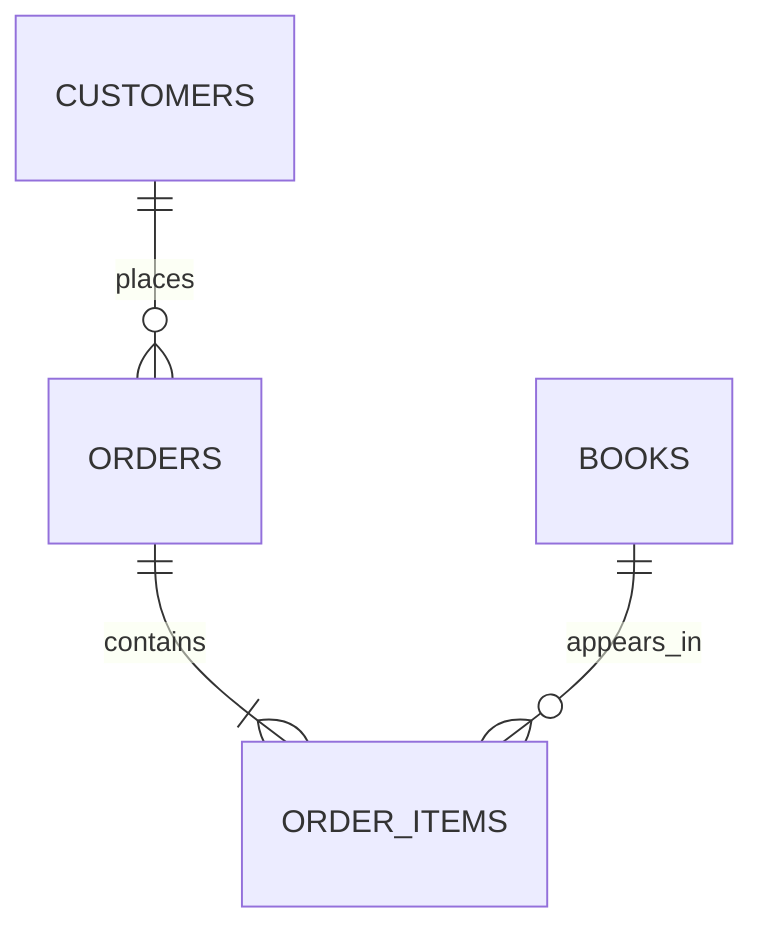

# Database and application design proposal

This document describes proposed business structure, not an implemented schema or database connection. The maintainer writes SQL and Go business code.

## Start with data

A table stores records with named columns. A primary key identifies one record. A foreign key connects records in different tables. Begin with the catalog; introduce related tables when its queries and constraints are understood.

| Proposed table | Purpose | Attributes to consider |
| --- | --- | --- |
| `books` | Editions and available stock | Identifier, ISBN, title, author, price, stock, creation time |
| `customers` | Fictional customer identities | Identifier, name, email, creation time |
| `orders` | Ownership and lifecycle | Identifier, customer reference, status, creation time |
| `order_items` | Purchased quantities and captured prices | Identifier, order reference, book reference, quantity, unit price |



The diagram describes valid committed orders. A foreign key alone does not ensure that an order has an item; order creation must enforce that condition.

## Decisions to document

- Identifier sizes and expected scale.
- Text lengths, ISBN representation, and email comparison policy.
- Currency and exact decimal price precision/scale.
- Required fields, unique keys, non-negative values, and positive quantities.
- Explicit `utf8mb4` collation and its comparison behavior.
- Timestamp/time-zone handling.
- InnoDB for transactional tables and retention of historical relationships.
- Uniqueness of a book within an order.
- Idempotency scope, payload comparison, and saved result behavior.

Use primary/unique keys and required foreign-key indexes deliberately. Add performance indexes in response to a measured query need, rather than indexing every column.

## Go application responsibilities

The existing `cmd/server/main.go` supplies startup and process health only. Future packages belong under `internal/`, following [Go's server-layout guidance](https://go.dev/doc/modules/layout).

Planned flow:

```text
HTTP request -> handler -> business coordination -> database access -> MySQL
HTTP response <- handler <- result or error <- database access <- MySQL
```

A handler owns HTTP details. Business coordination owns checkout/cancellation rules. Database access owns SQL execution and result handling. Keep the first path simple and split packages as responsibilities become concrete.

When integrating MySQL, study `database/sql` before choosing a driver. Understand the pool handle, contexts, errors, row iteration/closure, and transactions. All statements belonging to one local transaction must use that transaction's connection, rather than unrelated pooled connections. This remains maintainer implementation work.

Go goroutines can run concurrently. An in-process mutex cannot coordinate independent server instances. Protect shared database invariants using an explicit transaction and concurrency strategy.

## Future SQL organization

Keep schema changes, synthetic data, and experiments separate. Numbered scripts may help initial exercises; later document migration ordering and rerun behavior. The clean repository does not supply those implementations.

## Official references

- [Go database access](https://go.dev/doc/database/)
- [Go SQL package](https://pkg.go.dev/database/sql)
- [MySQL data types](https://dev.mysql.com/doc/refman/8.0/en/data-types.html)
- [MySQL table creation](https://dev.mysql.com/doc/refman/8.0/en/create-table.html)
- [MySQL CHECK constraints](https://dev.mysql.com/doc/refman/8.0/en/create-table-check-constraints.html)
- [MySQL locking reads](https://dev.mysql.com/doc/refman/8.0/en/innodb-locking-reads.html)
